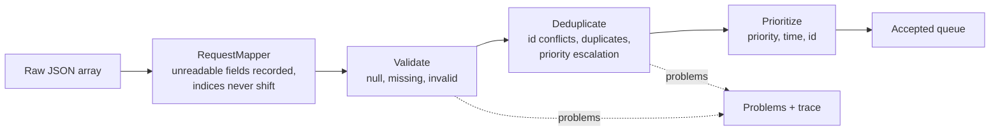

# Work Request Service

Validates, deduplicates and prioritizes batches of maintenance work requests, with a visual
step-through UI and an agent pipeline whose output has to pass the full test suite.

[](https://github.com/tanyasinghp/Work-Request-Service/actions/workflows/ci.yml)

**Live demo:** _link to come_ · **Video walkthrough (3 min):** _link to come_

Built as a follow-up to an interview exercise: the same batch problem, taken to a small but
production-shaped service.

## What it does

Send a batch of work requests (`requestId`, `equipmentId`, `priority`, `requestedAt`,
`description`), however messy, and get back:

- **accepted**: the valid, deduplicated requests in the order they should be worked on;
- **problems**: every issue found, each with the input position it came from;
- **trace**: what each stage did, which the UI reads to explain the result.

One bad request never fails the batch: missing fields, unreadable values, conflicting ids and
duplicates all become problems in a `200` response.

| Processing tab | Agent runs tab |
| --- | --- |
| _screenshot: docs/screenshots/processing.png_ | _screenshot: docs/screenshots/agent-runs.png_ |

## Run it

```bash
docker compose up --build
```

| What | URL |
| --- | --- |
| Web UI | <http://localhost:8081> (change with `WEB_PORT`) |
| API | <http://localhost:8080> |
| Swagger UI | <http://localhost:8080/swagger-ui.html> |
| Health | <http://localhost:8080/actuator/health> |

In the UI: **Load sample** → **Step ▶** (or **Run all**) → click a stage, a card or a problem →
**Shuffle & re-run**. **Edit batch** takes any JSON.

Without Docker: `cd backend && ./mvnw spring-boot:run` (JDK 21) and `cd web && npm ci && npm run dev`
(<http://localhost:5173>, calls the API at `VITE_API_URL`, default `http://localhost:8080`).
Deploying to Render and Vercel: [DEPLOY.md](DEPLOY.md).

## How it works



The controller takes the body as raw JSON, so a bad enum or date in one element can't fail
parsing. `RequestMapper` turns each element into a request, keeping unreadable fields aside so
the validator can report them as `INVALID_VALUE`. Three single-purpose stages then run in order,
each returning the requests it passes on, the problems it found and a trace entry.
`WorkRequestProcessor` only wires them together. The UI calls the API once per run and reveals
the stages one at a time from the response; it never re-implements the rules.

Stack: Java 21, Spring Boot 3.5, Maven; React 19, Vite, TypeScript, React Flow, Tailwind,
Framer Motion; Python 3 for the agent pipeline; Docker, GitHub Actions.

## API

| Method | Path | Purpose |
| --- | --- | --- |
| `POST` | `/api/work-requests/batch` | Process a JSON array of work requests → `{accepted, problems, trace}` |
| `GET` | `/api/work-requests/sample` | The 13-request demo batch, raw, ready to post back |
| `GET` | `/actuator/health` | Health (also used by Docker and Render) |
| `GET` | `/actuator/metrics/workrequests.rejected` | Problems by code; also `workrequests.processed`, `workrequests.batch.duration` |
| `GET` | `/swagger-ui.html`, `/v3/api-docs` | Interactive docs and the OpenAPI spec |

Whole-request failures all return `{status, error, message}`, never a stack trace:

- `400` for malformed JSON, a non-array body, or more than 5000 requests;
- `413` for a body over 2 MB, refused before parsing;
- `404`, `405` and `415` where they apply;
- a generic `500` for anything unexpected.

CORS allows only the configured front-end origins.

## Key design decisions

The full reasoning, with the alternatives considered, is kept in a decisions log; in short:

- **Problems are data, not exceptions.** Each problem has an input index, request id, code
  (`NULL_REQUEST`, `MISSING_FIELD`, `INVALID_VALUE`, `DUPLICATE`, `CONFLICTING_REQUEST_ID`), field,
  related request and message.
- **Validation runs before deduplication**, so an invalid request can never knock out a valid one.
- **Conflicting ids:** if any request under an id differs from another, every request under that
  id is rejected. We can't know which one is real. Byte-identical repeats are treated as duplicates.
- **Duplicates** match on equipment id (trimmed, case-insensitive) plus description (whitespace
  collapsed, lowercased). The earliest request survives (ties: lowest id), and its priority is
  **escalated** to the group's highest. The escalation is carried in structured
  `escalatedFrom`/`escalatedTo` fields, so the UI never parses message text.
- **Determinism:** the queue is ordered by priority weight (never `ordinal()`), then time, then
  id. The same batch in any order gives the same queue and trace, with trace notes sorted and
  index-free. Each tiebreak is enforced by its own comparator (see the M2/M4 finding below).
- **Unreadable values** (priority `"URGENT"`, a date without a zone, a number where a string
  belongs) are reported as `INVALID_VALUE` with the bad value quoted, never coerced. Non-object
  elements become `NULL_REQUEST`, so later indices never shift.
- **No input index in messages or trace notes**: messages name request ids, and the index has
  its own field, so output reads the same after a shuffle.

## Testing

| Layer | Tests | What they cover |
| --- | --- | --- |
| Backend: processing | 92 | each stage, the 15-row edge-case table (one parameterized test), order independence, the pinned sample batch |
| Backend: API | 70 | MockMvc: success, every error case, size and body limits, CORS, OpenAPI, the raw-JSON mapper, metrics and logging |
| Backend: domain, config, smoke | 20 | records, property validation, Spring wiring, a real-port smoke test (health, metrics) |
| Web (Vitest) | 32 | stage stepping, shuffle comparison, problem grouping, the escalated tag, journeys, agent-run parsing |
| Agent pipeline (pytest) | 77 | guardrails, schemas, gate-output parsing, the CLI backend, git safety, retries, export |

- **Coverage:** 96.8% of backend lines and 93.2% of branches. CI fails below 85% of lines.
- **Order independence:** the sample batch is shuffled 100 times with a fixed seed, and a
  generated 200-request batch 50 times. The batch covers every problem code, escalations, exact
  repeats, conflicts and unreadable values. The queue and trace must match exactly every time.
- **Mutation checks:** for every piece of logic whose tests passed on the first run, I broke
  the code on purpose, confirmed a test failed, and restored it: 67 deliberate bugs across the
  backend, web and pipeline, all caught in the end.
- **The M2/M4 finding:** two of those bugs at first survived the whole suite at 100% coverage.
  One removed the id tiebreak from duplicate survival; the other removed the escalation tie
  rule. A `TreeMap` in the conflict step was already ordering requests by id, so neither
  tiebreaker was ever deciding anything. The conflict step now keeps input order, so each rule
  is enforced only by its own comparator, and both bugs are caught.

Run everything: `cd backend && ./mvnw verify` · `cd web && npm run lint && npm test && npm run build` ·
`cd agent-pipeline && ruff check . && pytest`.

## Agent pipeline

[`agent-pipeline/`](agent-pipeline/README.md) turns a plain-English story into a reviewed
branch:

1. **Enrich** produces acceptance criteria as JSON, validated against a schema.
2. **Implement** produces a unified diff, written from the criteria and only the files they name.
3. **Write tests** works from the criteria alone, never seeing the diff.
4. **Gate** runs `./mvnw -q test`. A failure goes back to Implement once; a second failure stops the run.
5. **Summarize** writes a PR description.

The gate decides what's done, and a person reviews every branch.

**Guardrails, enforced in code before the gate:**
- only `backend/src` may change, never `pom.xml`, CI, the Maven wrapper or container config;
- no deleting, renaming, disabling or weakening tests (the number of test methods may never drop);
- every change is checked again on the working tree after `git apply`;
- commits go only to `agent/<story-id>`, and the pipeline never merges or pushes.

**Runs** (all on the `claude-cli` backend, claude-opus-5):

| Story | Completed | First-try gate pass | Attempts | What failed | Fixes needed by hand |
| --- | --- | --- | --- | --- | --- |
| Report future timestamps | yes, passed | yes | 1 | nothing | web UI doesn't know the new code |
| Flag stale requests (run 3) | yes, stopped | no | 2 | attempt 1 returned a placeholder diff; attempt 2 didn't add the new code to the generated test batch | extend that generator; a date bug; web UI |
| Cap Low-priority requests | yes, passed | no | 2 | attempt 1 broke Spring's binding of a config record; the gate caught it and attempt 2 fixed it | web UI; a design question |
| Flag stale requests (runs 1, 2) | no | – | 1 and 2 | the laptop slept mid-call; then a usage limit (HTTP 429) | – |
| Auto-escalate safety-critical | no | – | 0 | a call timed out during sleep; the retry returned 15 criteria (limit 12) | – |

Full logs, summaries and reviews are in [`agent-pipeline/runs/`](agent-pipeline/runs).

**The agent branches are unmerged on purpose.** Review found problems the gate couldn't see,
because no test was positioned to:

- the web UI doesn't know the new problem codes, and the agent may only edit `backend/src`;
- the stale-requests change would flag the demo sample as stale from 2026-11-20, because it
  pairs a 30-day limit with the real clock and the sample is dated 2026-10-20;
- the Low-priority cap lives inside the sorter, which is defensible but worth a design discussion.

| Branch | Review |
| --- | --- |
| [`agent/suspicious-timestamp`](https://github.com/tanyasinghp/Work-Request-Service/tree/agent/suspicious-timestamp) | [compare](https://github.com/tanyasinghp/Work-Request-Service/compare/main...agent/suspicious-timestamp) |
| [`agent/stale-requests`](https://github.com/tanyasinghp/Work-Request-Service/tree/agent/stale-requests) | [compare](https://github.com/tanyasinghp/Work-Request-Service/compare/main...agent/stale-requests) |
| [`agent/stale-requests-run2`](https://github.com/tanyasinghp/Work-Request-Service/tree/agent/stale-requests-run2) | [compare](https://github.com/tanyasinghp/Work-Request-Service/compare/main...agent/stale-requests-run2) |
| [`agent/low-priority-cap`](https://github.com/tanyasinghp/Work-Request-Service/tree/agent/low-priority-cap) | [compare](https://github.com/tanyasinghp/Work-Request-Service/compare/main...agent/low-priority-cap) |

**Infrastructure lessons from running it for real:**

- **Sleep vs. timeouts.** Python's subprocess timeout uses a monotonic clock, which stops while
  a laptop sleeps, so a call whose connection died during sleep hung for 37 minutes. Calls now
  have a wall-clock deadline.
- **Failed calls deserve a retry**, the same single retry as invalid JSON. A degenerate
  "placeholder" reply now counts as invalid output instead of using up an Implement attempt.
- **Usage limits are real.** One run stopped on the CLI account's session limit (HTTP 429). It's
  now reported plainly and recorded as an infrastructure failure, not an agent one.
- Also: a commit made in the IDE during a run landed on the agent branch, so the pipeline now
  stops if its branch moves underneath it.

**The `anthropic` backend** (Messages API with JSON-schema structured output) is implemented and
unit-tested, but has not yet been run against the live API. Every real run used `claude-cli`.

## AI usage

> **TODO (author):** how AI tools were used in building this, what was accepted, what was
> rejected or rewritten, and where review caught problems.

## Known limitations and next steps

- **Upgrade to Spring Boot 4.x first.** Spring Boot 3.5's open-source support ended on 2026-06-30.
  The project stays on the latest 3.5 patch (3.5.16) for now.
- **Add PIT mutation testing to CI**, so the manual mutation checks become automated.
- **Persistence and authentication:** batches are processed in memory per request; there's no
  database and no auth, by design for this scope.
- **The agent branches:** fix the review findings above before any merge, and run the
  `anthropic` backend against the live API.
- **Deployment:** Render's free tier sleeps after idle time, so the first request can take up
  to a minute. CORS needs each front-end origin listed exactly, so Vercel preview URLs need
  adding by hand.
- **No rate limiting**, and metrics live in each instance's memory (Prometheus or similar would
  be the next step).
